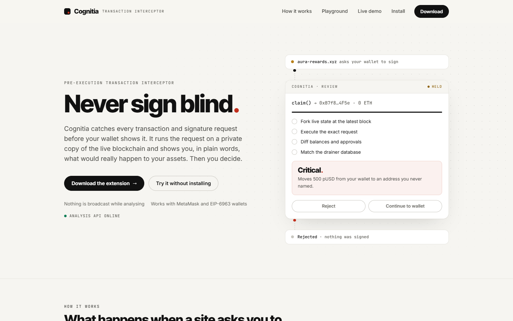
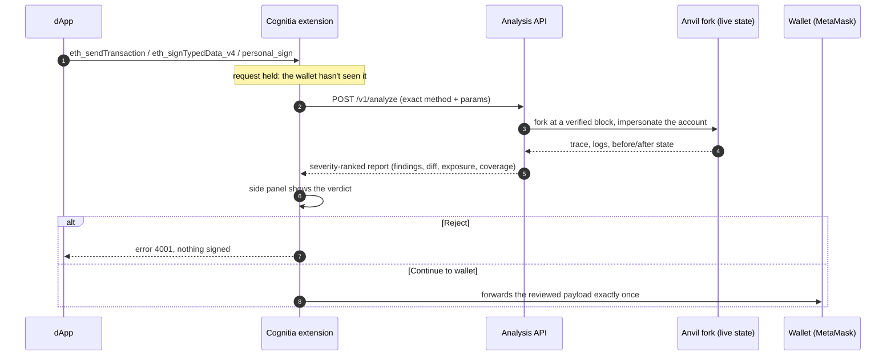
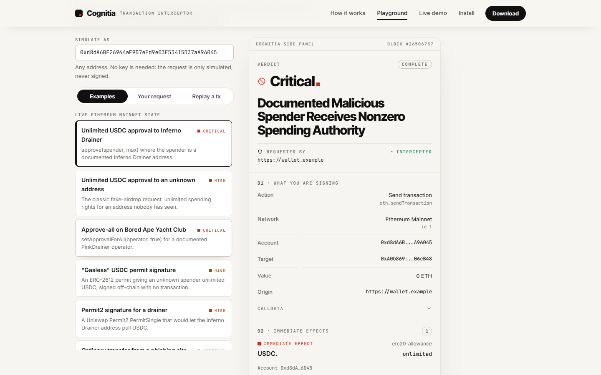
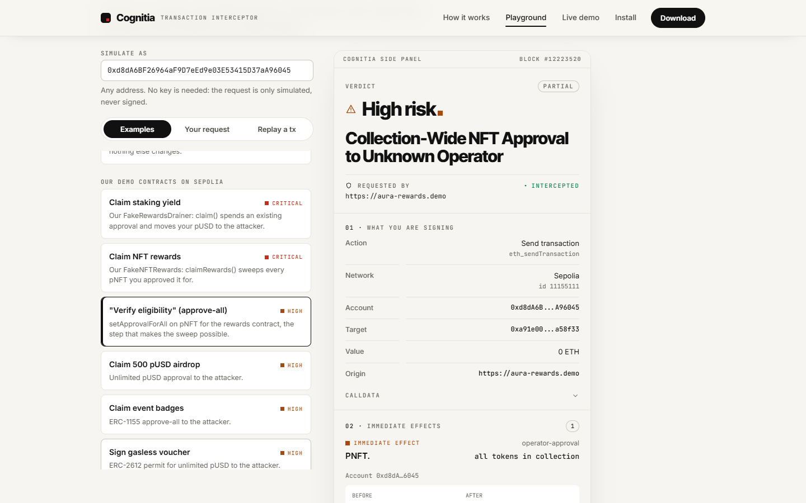
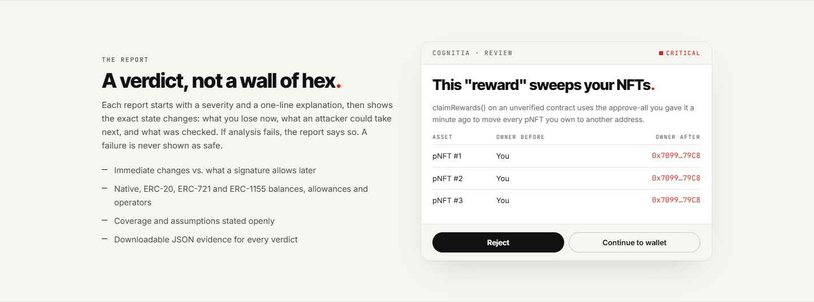
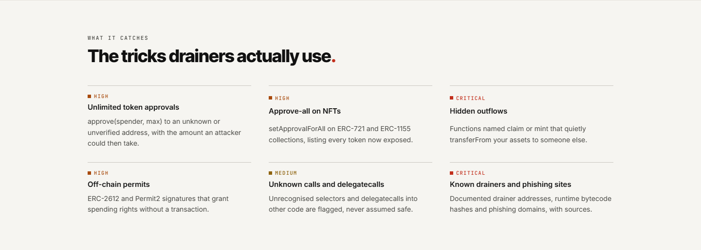
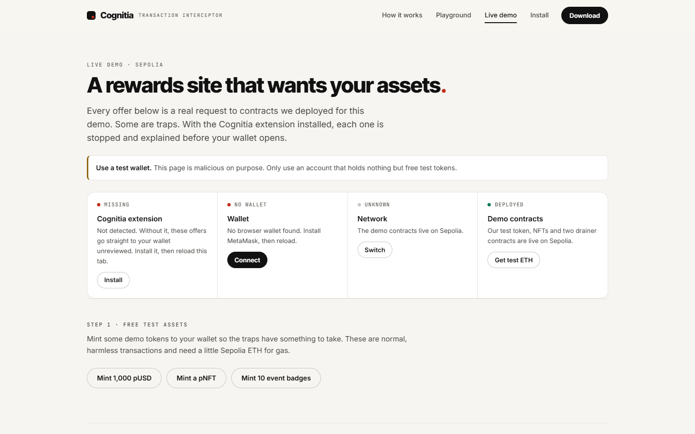
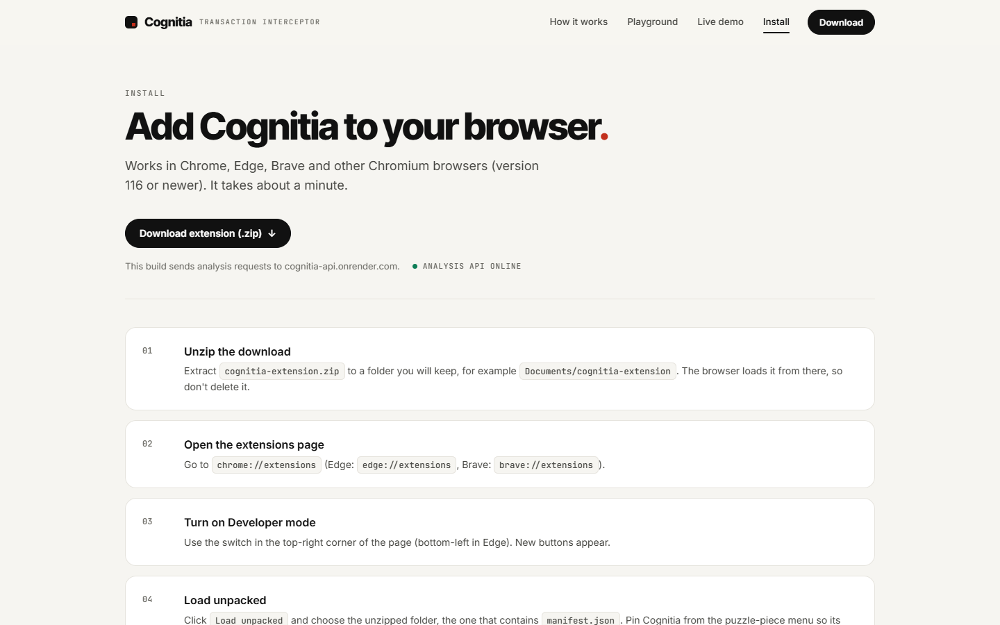
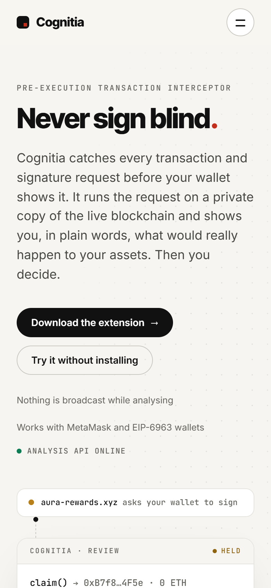
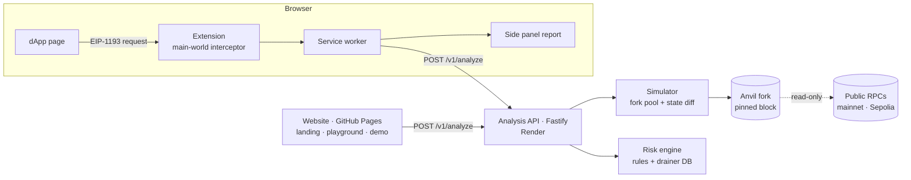

<div align="center">

# Cognitia

### Never sign blind.

**A pre-execution transaction interceptor and malicious signature simulator for EVM wallets.**<br>
Cognitia stops every transaction and signature request before your wallet shows it, runs it on a private fork of the live chain, and tells you in plain words what would really happen to your assets.

[**Live site**](https://mdasif678.github.io/Cognitia-private/) ·
[**Playground**](https://mdasif678.github.io/Cognitia-private/playground.html) ·
[**Live demo (Sepolia)**](https://mdasif678.github.io/Cognitia-private/demo.html) ·
[**Download the extension**](https://mdasif678.github.io/Cognitia-private/install.html)

[](https://github.com/MdAsif678/Cognitia-private/actions/workflows/ci.yml)
[](https://github.com/MdAsif678/Cognitia-private/actions/workflows/site.yml)
[](https://github.com/MdAsif678/Cognitia-private/actions/workflows/deploy-render.yml)

COGNITIA 2026 · Blockchain & Cybersecurity · **BLOCKCHAIN-PS2** · Team **Code-Blooded**



</div>

---

## Why

Wallet drainers don't hack wallets; they get people to sign. A "claim your airdrop" button asks for an unlimited token approval, a "verify eligibility" step asks for `setApprovalForAll`, and a "gasless" signature turns out to be a permit. The wallet shows hex and a gas fee. By the time the effect is visible, the assets are gone.

Cognitia sits between the site and the wallet. It **executes the exact request on a fork of the real chain first**, diffs every balance, allowance and owner it touched, decodes the intent, matches known drainer infrastructure, and shows a severity-ranked verdict. You reject or continue *before* anything is signed. Nothing is broadcast during analysis.

## How it works



1. **Intercept.** The extension wraps the page's EIP-1193 provider (and EIP-6963 announced wallets) in the page's main world, so it sees the request before the wallet does.
2. **Simulate.** The API starts an isolated Anvil fork pinned to a verified recent block, impersonates the user's account, and runs the exact request. Signatures such as ERC-2612 permits are modelled as the authority they would grant.
3. **Diff.** Native and ERC-20 balances, ERC-20 allowances, ERC-721 ownership and approvals, ERC-721/1155 operator approvals (`isApprovedForAll`), and ERC-1155 balances: before and after.
4. **Decide.** Findings come from calldata decoding, trace analysis (hidden `transferFrom`, `delegatecall` to unverified code), and a drainer signature database. Each report gets a severity: Low, Medium, High or Critical.
5. **Explain.** The report says what you lose now, what an attacker could take later, what was checked and what couldn't be. A failed analysis is never shown as safe.

## Screenshots

| Live mainnet analysis (playground) | Our Sepolia drainer, analysed live |
|---|---|
|  |  |
| An unlimited USDC approval to a documented **Inferno Drainer** address, simulated on **real Ethereum mainnet state** → **Critical**. | `setApprovalForAll` to our **FakeNFTRewards** contract on **Sepolia** → **High**: "could take every current and future token". |

| The report | What it catches |
|---|---|
|  |  |

| Live demo: a malicious dApp on Sepolia | Install | Mobile |
|---|---|---|
|  |  |  |

## Try it

| | What you need | What you see |
|---|---|---|
| [**Playground**](https://mdasif678.github.io/Cognitia-private/playground.html) | Nothing | Run real attack patterns against **live Ethereum mainnet**, paste any wallet request, or replay a mined transaction hash. Renders the extension's real report component. |
| [**Extension**](https://mdasif678.github.io/Cognitia-private/install.html) | Chrome + MetaMask | Download the ZIP → `chrome://extensions` → Developer mode → **Load unpacked**. Every request on every site is held and analysed before MetaMask opens. |
| [**Live demo**](https://mdasif678.github.io/Cognitia-private/demo.html) | Extension + a **test** wallet with a little Sepolia ETH | A deliberately malicious "rewards" dApp built on our own deployed contracts. Mint test assets, take an offer, watch Cognitia stop it. |

> Use a test wallet for the live demo. The page is malicious on purpose.

## Problem statement coverage

| PS2 requirement | How Cognitia meets it | Where |
|---|---|---|
| **1. Live state fork simulation** | Isolated Anvil fork per request, pinned to a verified block and block hash; upstream RPCs are only read. Mainnet and Sepolia, with rotating keyless public RPCs. | `packages/simulator` |
| **2. Before/after state diff** | Native and ERC-20 balances, ERC-20/721/1155 allowances and approvals, `isApprovedForAll`, ERC-721 ownership, ERC-1155 balances. Immediate effects are kept separate from what a signature allows *later*. | `packages/simulator`, `services/api/src/engine` |
| **3. Calldata decoding and danger statements** | Decodes standard calldata and flags unknown selectors. Plain-language findings for unlimited approvals to unverified/unknown spenders, `transferFrom` to non-owners, and `delegatecall` to unverified bytecode. A proxy forwarding to its own implementation is *not* flagged. | `services/api/src/engine`, `incoming/swastik-risk-engine`, `incoming/integration` |
| **4. Drainer-kit signature database** | Chain-scoped records for documented drainer contracts (Inferno Drainer, PinkDrainer) and phishing domains (MetaMask's detect list), plus exact runtime bytecode-hash matching from fork observations. Each match carries its provenance. The database is deliberately small; see *Honest limits*. | `incoming/swastik-risk-engine` |
| **5. Your own malicious contract** | **FakeNFTRewards**: "verify eligibility" (`setApprovalForAll`) then `claimRewards()` sweeps every NFT. **FakeRewardsDrainer**: `claim()` spends an existing approval. Both are deployed to Sepolia by GitHub Actions. | `incoming/ps2-project/src` |
| **6. Real wallet interception** | MV3 extension: EIP-1193 + EIP-6963 interception before signing, immutable reviewed payload, Reject → 4001, Continue → forwarded exactly once. | `incoming/atif-extension` |
| **7. Severity-ranked report** | Low / Medium / High / Critical verdicts, with findings, evidence, assumptions, coverage gaps and downloadable JSON. | extension side panel, playground |
| **Deployable live via GitHub Actions** | Site → GitHub Pages; API → Render (deploys after checks pass); contracts → Sepolia. All from Actions. | `.github/workflows` |

## Live deployment

| Piece | Where | Deployed by |
|---|---|---|
| Website | https://mdasif678.github.io/Cognitia-private/ | **Publish site** → GitHub Pages |
| Analysis API | [cognitia-api.onrender.com](https://cognitia-api.onrender.com/health) ([`/health`](https://cognitia-api.onrender.com/health) · [`/ready`](https://cognitia-api.onrender.com/ready)) | Render Blueprint (`render.yaml`), deployed after **MVP checks** pass |
| Extension ZIP | [cognitia-extension.zip](https://mdasif678.github.io/Cognitia-private/downloads/cognitia-extension.zip) | Built in **Publish site** against the live API |
| Demo contracts | Sepolia (below) | **Deploy demo contracts to Sepolia** |

**Sepolia contracts** (`incoming/ps2-project/deployments/sepolia.json`):

| Contract | Role | Address |
|---|---|---|
| FakeNFTRewards | "Claim rewards" NFT sweeper | [`0x1e7527b5…1ffd`](https://sepolia.etherscan.io/address/0x1e7527b5b84a0e4389e726e5539c26198dfd1ffd) |
| FakeRewardsDrainer | `claim()` spends an existing pUSD approval | [`0x97c08bcb…ccdaa`](https://sepolia.etherscan.io/address/0x97c08bcbbe62c8d1524c9690fd46db49f1dccdaa) |
| MaliciousTokenApprover | Approval bait | [`0xbc978394…4d9a`](https://sepolia.etherscan.io/address/0xbc978394f7d364bc62b72f734e6df9adce834d9a) |
| TestToken (pUSD) | Test ERC-20 with ERC-2612 permits | [`0x7a2a73fc…7948`](https://sepolia.etherscan.io/address/0x7a2a73fc0c3a74767efa3894aeaee283f8517948) |
| TestNFT (pNFT) | Test ERC-721 | [`0xa91e001c…8f33`](https://sepolia.etherscan.io/address/0xa91e001c011efe763d8ff634f5b4bad3bba58f33) |
| TestERC1155 | Test ERC-1155 badges | [`0x412d5acc…960f`](https://sepolia.etherscan.io/address/0x412d5accf7ab5dd165736ab82c9258d6f30e960f) |

The whole stack runs on free tiers with no keys: public RPCs, GitHub Pages and Render's free plan (kept awake by a 10-minute ping). Step-by-step guide: **[docs/DEPLOY.md](docs/DEPLOY.md)**.

## Architecture



| Path | What it is |
|---|---|
| `apps/site` | Public website (Vite): landing, install, playground, live Sepolia demo |
| `incoming/atif-extension` | Chrome MV3 extension: interceptor, service worker, side-panel report |
| `services/api` | Analysis API (Fastify): `/v1/analyze`, `/v1/replay`, `/ready` |
| `packages/simulator` | Fork pool, request execution, before/after diff, RPC rotation |
| `packages/shared` | Shared schemas and types |
| `incoming/swastik-risk-engine` | Deterministic risk rules, calldata decoding, threat database |
| `incoming/integration` | Bridge between the simulator and the risk engine |
| `incoming/ps2-project` | Solidity: test assets, drainer contracts, Foundry tests, deploy script, local bait dApp |
| `scripts` | Local demo launcher, deploy helpers, smoke tests, site build |
| `render.yaml`, `deploy/` | Render Blueprint; Docker/VM alternative (Caddy, compose, bootstrap) |

## Run it locally

Needs **Node 22+**, **Python 3** and **[Foundry](https://getfoundry.sh/introduction/installation/)** (`anvil`, `forge`, `cast`).

```sh
npm ci
cd incoming/ps2-project
forge install foundry-rs/forge-std@v1.16.2 --no-git
forge install OpenZeppelin/openzeppelin-contracts@v5.7.0 --no-git
cd ../..

npm run dev:demo      # local chain 31337 + contracts + seeded victim + API on :8080 + bait dApp on :3000
npm run dev:site      # website on http://127.0.0.1:5180
```

For the website against the local stack, create `apps/site/.env.local` (gitignored):

```sh
SITE_API_BASE_URL=http://127.0.0.1:8080
SITE_DEMO_DEPLOYMENT=incoming/ps2-project/demo/deployment.json
```

If other projects use those ports: `DEMO_RPC_PORT=18545 DEMO_API_PORT=18080 DEMO_WEB_PORT=13000 npm run dev:demo`.

<details>
<summary><b>Build and load the extension locally</b></summary>

```sh
API_BASE_URL=http://localhost:8080 npm run build -w @cognitia/extension
# or take the API URL from the running demo deployment:
npm run build:demo-extension
```

Load `incoming/atif-extension/dist` unpacked from `chrome://extensions`, then reload the dApp. Use a disposable Anvil account, never a funded wallet. Anvil's first development account (`0xf39F…2266`) is the seeded victim that reproduces the hidden 500 pUSD drain.

- **Reject** cancels with code 4001.
- **Continue to wallet** forwards the captured payload once.
- Supported: transactions, ERC-2612 typed data and `personal_sign`. Unsupported signing variants are blocked.
- Changing account or chain invalidates a pending review, and a second request can't overwrite an open review.
- A failed analysis offers an explicit "continue without analysis". It is never presented as safe.

</details>

<details>
<summary><b>API reference</b></summary>

| Endpoint | Purpose |
|---|---|
| `GET /health` | Process status, versions, configured chains, fork pool |
| `GET /ready` | Checks each upstream chain's identity and readiness (reports host names, never full RPC URLs) |
| `GET /v1/chains` | Supported chains |
| `POST /v1/analyze` | `{ requestId, origin, chainId, account, method, params }`: the exact wallet request |
| `POST /v1/replay` | `{ chainId, txHash }`: replays a mined transaction against the end of the previous block |

No RPC keys are needed: chains 1 and 11155111 use keyless public endpoints with fallbacks. An endpoint that rate-limits is parked and the next one used. `RPC_URL_<chainId>` overrides a chain's list (highest preference first). Analysis budget: 45 s (the extension waits 55 s). Optional `THREAT_DB_FILE` adds independently sourced `ThreatRecord`s; demo indicators need `THREAT_INCLUDE_DEMO=true`.

```sh
cp services/api/.env.example services/api/.env
npm run dev:api
```

</details>

## Tests

```sh
npm run typecheck
npm test                              # shared, simulator, API, risk engine, extension (60 report/interception tests)
forge test --root incoming/ps2-project
npm run test:wallet                   # demo dApp wallet session: connect, accounts, network switching
npm run test:demo                     # with dev:demo running: 10 attack scenarios through the real HTTP API
npm run test:packaged                 # the bundled production API, from an isolated folder
npx playwright install chromium && npm run test:extension   # built MV3 extension in Chromium
npm run test:mainnet                  # optional read-only live mainnet fork check
```

The smoke tests send every demo request through the real API:
- validate each response with the extension's schema
- check expected severities and state changes
- confirm the upstream block is unchanged

Evidence is written to `artifacts/`.

## CI/CD (GitHub Actions)

| Workflow | Trigger | What it does |
|---|---|---|
| **MVP checks** | push / PR | Clean install, typecheck, every test suite, contract tests, demo smoke tests, extension and evidence artifacts, Docker build |
| **Publish site** | push to `main`, after deploys | Builds the extension ZIP against `ANALYSIS_API_URL`, builds the site, deploys to GitHub Pages |
| **Deploy analysis API to Render** | after MVP checks pass on `main` | Render deploys the checked commit (`autoDeployTrigger: checksPass`); the workflow waits for `/ready` and republishes the site |
| **Deploy demo contracts to Sepolia** | manual | Tests the contracts, deploys with Sepolia's own gas estimates (Glamsterdam pricing), commits the addresses, republishes the site |
| **Keep analysis API awake** | every 10 min (backup) | Pings `/health`; the main keep-alive is an external cron job |
| **Deploy analysis API** (VM) | manual | Alternative: GHCR image → any Docker VM over verified SSH, behind Caddy HTTPS |

No secrets are stored in the repository. Deploy keys live in GitHub environment secrets.

## Honest limits

- **Not a wallet-level guarantee.** Interception wraps the page's provider. Direct RPC transports, pre-cached providers, other frames and legacy signing paths can bypass it.
- **The threat database is small and bundled.** It isn't a live intelligence feed. No match is not proof of safety, and unknown bytecode is not proof of malice.
- **Signatures are modelled.** An unsigned permit is shown as the authority it *would* grant if submitted. Its domain, signer, nonce and deadline checks are disclosed.
- **Coverage is bounded.** Asset discovery uses calldata, logs, traces and hints, not a full wallet inventory. Gaps are listed in each report.
- **Free-tier hosting.** Public RPCs can rate-limit. If the API was idle, the first request can take longer.

---

<div align="center">

Built by team **Code-Blooded** for **COGNITIA 2026**, Blockchain & Cybersecurity, PS2.

</div>
